<picture>
  <source media="(prefers-color-scheme: dark)" srcset="assets/hero-dark.svg">
  
</picture>

 

<picture>
  <source media="(prefers-color-scheme: dark)" srcset="assets/h-about-dark.svg">
  
</picture>

Getting straight to the point: I build interfaces for a living, but I don't like working with a black box.

Every abstraction I use eventually makes me curious about the layer underneath it. React led me to the browser's rendering pipeline. `fetch` led me to sockets. "Just use Redis" led me to write a tiny one in C++ to see what it actually does with the bytes.

This profile is where that curiosity lives: small, honest programs written close to the metal, mostly to understand how things *really* work.

And the most important thing: **I use Vim.** Trust me, you should too.

 

<picture>
  <source media="(prefers-color-scheme: dark)" srcset="assets/h-lowlevel-dark.svg">
  
</picture>

<picture>
  <source media="(prefers-color-scheme: dark)" srcset="assets/p-redis-dark.svg">
  
</picture>

A TCP server and client that speak their own **length-prefixed binary protocol**: a 4-byte header carries the message length, then the body follows.

- `read_full` / `write_full` loops, because `read()` and `write()` are allowed to hand you *less* than you asked for.
- Guarding against oversized payloads before they ever touch the buffer.
- Thread-per-connection with `pthread_create` + `pthread_detach`: the simplest concurrency model, so I can feel exactly where it breaks.

 

<picture>
  <source media="(prefers-color-scheme: dark)" srcset="assets/p-lru-dark.svg">
  
</picture>

A least-recently-used cache in plain C. A **doubly linked list** tracks recency (head is fresh, tail is next to go), and a lookup table maps keys to values. On a hit the node moves to the front; when the cache is full the tail gets evicted. No libraries, just `malloc` and pointers.

 

<picture>
  <source media="(prefers-color-scheme: dark)" srcset="assets/p-socket-dark.svg">
  
</picture>

A raw C client (`socket` → `connect` → `write` → `read`) talking to a Node.js server, to see what's left once the frameworks are gone: byte order, `sockaddr_in`, and a file descriptor.

 

<picture>
  <source media="(prefers-color-scheme: dark)" srcset="assets/p-brackets-dark.svg">
  
</picture>

Streams a file one character at a time and validates `()[]{}` nesting with a hand-rolled stack. Written twice: the second version is what I wrote after rereading the first.

 

<picture>
  <source media="(prefers-color-scheme: dark)" srcset="assets/h-building-dark.svg">
  
</picture>

<picture>
  <source media="(prefers-color-scheme: dark)" srcset="assets/p-togetherlab-dark.svg">
  
</picture>

A collaborative workspace where several people edit the same document **in real time**, with live cursors, presence, version history, and recovery after a dropped connection.

The fun part is the system design:

- **CRDTs (Yjs)** so concurrent edits merge without a central lock.
- A **modular monolith** first: auth, workspaces, documents and collaboration stay as separate modules inside one deployable.
- **Redis only when it's earned.** Get one instance right, then scale out and coordinate between instances.

 

<picture>
  <source media="(prefers-color-scheme: dark)" srcset="assets/h-toolbox-dark.svg">
  
</picture>

<picture><source media="(prefers-color-scheme: dark)" srcset="assets/l-low-dark.svg"></picture>
<picture><source media="(prefers-color-scheme: dark)" srcset="assets/chips-low-dark.svg"></picture>

<picture><source media="(prefers-color-scheme: dark)" srcset="assets/l-web-dark.svg"></picture>
<picture><source media="(prefers-color-scheme: dark)" srcset="assets/chips-web-dark.svg"></picture>

<picture><source media="(prefers-color-scheme: dark)" srcset="assets/l-data-dark.svg"></picture>
<picture><source media="(prefers-color-scheme: dark)" srcset="assets/chips-data-dark.svg"></picture>

 

<picture>
  <source media="(prefers-color-scheme: dark)" srcset="assets/h-shelf-dark.svg">
  
</picture>

- **Designing Data-Intensive Applications** by Martin Kleppmann: the book behind most of my "wait, how does *that* work?"
- **Dive into Systems**: C, memory, and the machine underneath it all.
- **Code** by Charles Petzold: from flashlights to CPUs.
- **Network Programming**: sockets, the way the OS sees them.
- **The Pragmatic Programmer**: habits that outlive any framework.
- **Refactoring UI**: because the front-end still has to look good.

 

<picture>
  <source media="(prefers-color-scheme: dark)" srcset="assets/h-beliefs-dark.svg">
  
</picture>

> I've never been someone who follows the herd.

Give people a coding agent and every idea starts to look like a nail. I still care about **architecture, code quality, and long-term maintainability**. AI should help us think better and build better software, not replace the part where we think critically and make sound engineering decisions.

 

<picture>
  <source media="(prefers-color-scheme: dark)" srcset="assets/h-setup-dark.svg">
  
</picture>

- **Arch Linux** with **Sway**, themed Gruvbox end to end: bar, launcher, terminal, cursor.
- **Vim** for everything.
- A `systemd` user service that plays a **sped-up Windows XP startup sound** whenever I plug in the charger. Is it necessary? No. Does it bring me joy every single time? Absolutely.

 

<picture>
  <source media="(prefers-color-scheme: dark)" srcset="assets/h-hello-dark.svg">
  
</picture>

Happy to talk about sockets, caches, CRDTs, or why your component re-renders.

<a href="https://tejassharma.in"><picture><source media="(prefers-color-scheme: dark)" srcset="assets/b-portfolio-dark.svg"></picture></a>&nbsp;&nbsp;<a href="mailto:sharmatejas000@gmail.com"><picture><source media="(prefers-color-scheme: dark)" srcset="assets/b-email-dark.svg"></picture></a>

 

<picture>
  <source media="(prefers-color-scheme: dark)" srcset="assets/divider-dark.svg">
  
</picture>

<picture>
  <source media="(prefers-color-scheme: dark)" srcset="assets/footer-dark.svg">
  
</picture>
